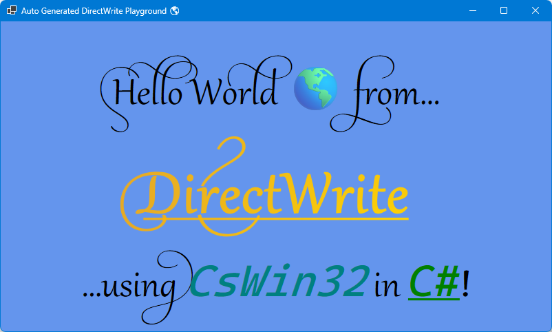

# Auto-gen Direct Write Playground

This is an experiment investigating using the awesome [CsWin32](https://github.com/microsoft/CsWin32) [Nuget package](https://www.nuget.org/packages/Microsoft.Windows.CsWin32) to draw to a Windows Forms UserControl using Direct Write through a GDI DC.  

